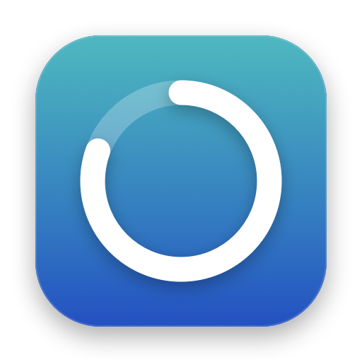

<p align="center">
  
</p>

<h1 align="center">Stint</h1>

<p align="center">
  A calm focus timer for your Mac's menu bar.<br>
  <a href="../../releases/latest"><b>Download</b></a> · <a href="#getting-started">Getting started</a> · <a href="docs/GUIDE.md">Guide</a>
</p>

---

Stint is a free, open-source Pomodoro timer for macOS. Work in focused stretches, take real breaks, and see where your time went, all in a pane of Liquid Glass.

- **Lives in your menu bar.** A ring, dial, digits or flip tiles show your session at a glance.
- **Four clock faces.** Ring, kitchen-timer dial, digital, or a mechanical split-flap.
- **Lock-In.** No pausing or skipping until the session is done.
- **Fewer distractions.** Hide chosen apps and block websites while you focus.
- **History.** Charts by day, week, month and year, with on-device summaries from Apple Intelligence.
- **Yours.** Themes, a custom color, or glass that matches your wallpaper. Tags can have their own timers.

## Install

1. Download **Stint-x.y.dmg** from the [latest release](../../releases/latest).
2. Open it and drag **Stint** into **Applications**.
3. Open Stint. It appears in the menu bar, not the Dock.

> **macOS stops the first launch?** Open **System Settings › Privacy & Security** and click **Open Anyway** next to Stint. You only need to do this once.

Requires macOS 27 on Apple silicon. Summaries need Apple Intelligence turned on (optional).

## Getting started

| To | Do this |
|---|---|
| Show or hide the timer | Click Stint in the menu bar |
| Start, pause or skip | Use the buttons on the timer, or right-click the menu bar icon |
| Set a different time | Click the countdown, pick a time, then click anywhere outside |
| Name a session | Click "Add a title" under the time |
| Change the look | Right-click the timer › **Clock Style**, or open **Settings** (⌘,) |
| See your history | Right-click the menu bar icon › **History** |

## Build from source

You need Xcode 27.

```bash
git clone https://github.com/j4bush14/Stint.git && cd Stint
make install
```

`make help` lists everything else (run, test, package).

## Learn more

- [**Guide**](docs/GUIDE.md): shortcuts, AppleScript and links, building and testing, releasing, and how the code is organized
- [**Website**](site/README.md): the project's site

## Privacy

No accounts, no analytics, no servers. Your sessions stay in a file on your Mac, and summaries are written by the on-device model. macOS asks before Stint controls a browser (for website blocking) or adds to your calendar.
