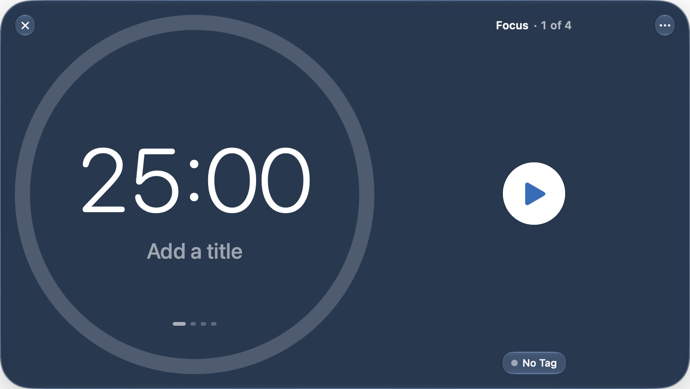

<p align="center">
  
</p>

<h1 align="center">Stint</h1>

<p align="center">
  <strong>A calm focus timer for the Mac menu bar.</strong>
</p>

<p align="center">
  <a href="https://github.com/j4bush14/Stint/actions/workflows/ci.yml"></a>
  <a href="https://github.com/j4bush14/Stint/releases/latest"></a>
  
  
</p>

<p align="center">
  <a href="https://j4bush14.github.io/Stint/">Website</a> ·
  <a href="https://github.com/j4bush14/Stint/releases/latest">Download</a> ·
  <a href="#usage">Usage</a> ·
  <a href="docs/GUIDE.md">Guide</a>
</p>

<p align="center">
  
</p>

Stint is a free, open-source Pomodoro timer for macOS. It keeps a gentle rhythm of focused work and real breaks, shows your progress at a glance from the menu bar, and records where your time went, all in a pane of Liquid Glass.

## Features

- **Menu bar first.** The menu bar item takes the shape of your clock face, with a second hand that sweeps while you work. Click it for the timer; right-click for every command.
- **Four clock faces.** A progress ring, a kitchen-timer dial, clean digits, or a mechanical split-flap display.
- **A window that fits anywhere.** Resize it from a slim bar to full screen; the layout adapts, and the corners and edges are easy to grab.
- **Lock-In.** Once a focus session starts, pausing and skipping stay off until it ends.
- **Fewer distractions.** Hide chosen apps and redirect chosen websites during focus sessions only.
- **History.** Daily, weekly, monthly and yearly charts by tag, CSV export, and on-device summaries written by Apple Intelligence.
- **Your look.** Six themes, a custom color, or clear glass that takes its colors from the wallpaper behind it.
- **Automation.** Global keyboard shortcuts, AppleScript, `stint://` links and Calendar logging.

## Requirements

- macOS 27 or later
- A Mac with Apple silicon
- Apple Intelligence, optionally, for written summaries

## Installation

1. Download **Stint-&lt;version&gt;.dmg** from the [latest release](https://github.com/j4bush14/Stint/releases/latest).
2. Open the disk image and drag **Stint** into **Applications**.
3. Open Stint from Applications. It appears in the menu bar rather than the Dock.

Releases are not notarized, so macOS blocks the first launch. To allow it, open **System Settings › Privacy & Security** and click **Open Anyway** next to Stint. This is needed only once.

## Usage

| To | Do this |
|---|---|
| Show or hide the timer | Click Stint in the menu bar |
| Start, pause, reset or skip | Use the buttons on the timer, or right-click the menu bar item |
| Set a different length | Click the countdown, choose a time, then click anywhere outside it |
| Name the session | Click **Add a title** below the time |
| Change the clock face | Right-click the timer › **Clock Style**, or open **Settings** (⌘,) |
| Review your history | Right-click the menu bar item › **History** |

Keyboard shortcuts, AppleScript commands and `stint://` links are listed in the [Guide](docs/GUIDE.md#automation).

## Building from source

Stint is a Swift package. Building it requires Xcode 27.

```bash
git clone https://github.com/j4bush14/Stint.git
cd Stint
make install
```

`make install` builds `Stint.app` and copies it to `/Applications`. Run `make help` for the other tasks, including tests and packaging.

## Documentation

- [Guide](docs/GUIDE.md): automation, building and testing, releasing, architecture and design notes
- [Website](site/README.md): the source of the project site

## Privacy

Stint has no accounts, analytics or network services. Sessions are stored in a file on your Mac, and summaries are generated by the on-device model. macOS asks for permission before Stint controls a browser (for website blocking) or writes to your calendar.

## Contributing

Bug reports and pull requests are welcome. Please open an [issue](https://github.com/j4bush14/Stint/issues) to discuss larger changes first. `make test` runs the full test suite.

## Acknowledgements

Stint was designed and built with the assistance of AI tools, including Anthropic's Claude Code, working alongside its author. All changes were reviewed, tested and verified in the running app.
